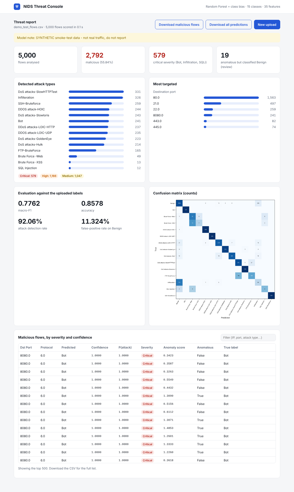

# Network Intrusion Detection on CSE-CIC-IDS2018

> **مسلم: تعليماتك ومهامك هنا ← [CONTRIBUTING.md](CONTRIBUTING.md)** (ملخص بالعربي في أول الملف، والمهام في القسم 3). **المشروع اكتمل: اقرأ القسم 9 (الخطوة التالية).**
> **Mesalam: your tasks are in [CONTRIBUTING.md](CONTRIBUTING.md), Section 3.**

MSCS 640 project: a three-phase pipeline that goes from the raw CICFlowMeter
CSVs to a deployed SOC threat-detection dashboard.

| Phase | What it does | Code |
|---|---|---|
| 1. Data engineering | Two-pass chunked loading of all 10 days, cleaning (Inf/NaN, repeated headers, ID columns, duplicates, label conflicts), class-capped stratified sampling, feature selection, SMOTE + class weights | `nids/data.py`, `nids/features.py`, `nids/imbalance.py` |
| 2. Models | Random Forest baseline, XGBoost (falls back to scikit-learn's histogram GBDT), MLP, soft-voting ensemble, validation-tuned class-bias decision rule, benign-only autoencoder; macro-F1 model selection | `nids/models.py`, `nids/pipeline.py`, `nids/evaluate.py` |
| 3. Deployment | Flask dashboard: upload a CSV, get a threat report (severity triage, attack mix, top targets, anomaly flags, live metrics if labels are present), CSV export, JSON API | `webapp/` |

**Live demo: <https://ids.batch5ai.lol>** (Arabic by default; <https://ids.batch5ai.lol/?lang=en> opens it in English) - click "Or run on the bundled held-out test sample" or upload a CICFlowMeter
CSV (up to 50 MB on the demo server). Results of the final model are in
[`docs/EXPERIMENTS.md`](docs/EXPERIMENTS.md).

The headline metric is **macro-F1**. The test split is used once, for
reporting only: early stopping, model selection and decision tuning all use
the validation split.

---

## 1. Setup

Python 3.10+.

```bash
git clone <repo-url> nids && cd nids
python -m venv .venv && source .venv/bin/activate      # Windows: .venv\Scripts\activate
pip install -r requirements.txt
```

On a fresh Windows machine (see [`docs/REPRODUCIBILITY.md`](docs/REPRODUCIBILITY.md)): if `python`
opens the Microsoft Store, install Python first (`winget install --id Python.Python.3.12 -e --scope user`)
and reopen the terminal; if `.venv\Scripts\activate` says running scripts is disabled, run
`Set-ExecutionPolicy -Scope CurrentUser RemoteSigned` once and activate again.

## 2. Smoke test (about 3 minutes, no download)

This generates synthetic flows with the exact CSE-CIC-IDS2018 schema and runs
every phase on them.

```bash
python -m pytest -q                                   # unit + end-to-end tests
python main.py --config configs/smoke.json synth
python main.py --config configs/smoke.json all
python main.py serve --model models/smoke/nids_bundle.joblib   # http://127.0.0.1:5000
```

Synthetic data is only for checking that the code runs. Never report results on it.

## 3. Full run on the real dataset

```bash
python main.py download          # all 10 days (about 6.4 GB) into data/raw/
#   or: python main.py download --smallest   (Thursday-01-03, 103 MB, for debugging)
#   or the instructor's command: aws s3 sync --no-sign-request s3://cse-cic-ids2018/ .
#      (then point paths.raw_dir in a config at the folder holding the CSVs)

python main.py all               # prepare + train  (add --tune for the GBDT random search)
python main.py serve             # dashboard on the trained model
```

`download` uses the AWS CLI if it is installed and falls back to plain
HTTPS, with resume support. The prepare step streams the files, so peak memory
depends on the sample caps, not on the size of the dataset. The
Thursday-01-03 day is the place to debug. To run on it alone:

```bash
python main.py download --smallest && python main.py all
```

### Outputs

| Path | Content |
|---|---|
| `data/processed/flows_sample.pkl` (+ `.summary.json`) | cleaned, de-duplicated sample and EDA counts (missing/Inf per column, label counts per day, duplicates removed) |
| `models/nids_bundle.joblib` | frozen preprocessor + selected model + label map + autoencoder |
| `models/demo_test_flows.csv` | 5,000 held-out test flows (every class) for the live demo |
| `reports/results.json` | all metrics for every model on validation and test, per-class scores, tuning trials |
| `paper/generated/*.tex`, `paper/figures/*` | LaTeX tables, confusion matrix, ROC curves, feature importance, class distribution, autoencoder scores; the paper includes these directly |

### Hidden test set / leaderboard

The final trained model ships with the repository (`models/nids_bundle.joblib`, 12.7 MB:
XGBoost + class bias, test macro-F1 0.864 over 15 classes; checksums in `models/SHA256SUMS`),
so scoring needs no download and no training. After Section 1:

```bash
python main.py predict path/to/hidden_test.csv -o reports/predictions.csv
```

`requirements.txt` pins the exact library versions the model was trained with; the bundle is
a joblib pickle and is only guaranteed to load with them. To check the setup, score the
shipped demo sample, which carries true labels (expected macro-F1 0.879, accuracy 0.935 on a fresh clone):
`python main.py predict models/demo_test_flows.csv -o reports/demo_predictions.csv`.

The output has one row per input flow. `Label` holds the predicted class,
using the dataset's exact spellings, alongside the confidence, P(attack),
severity and anomaly score. Large files are scored in chunks.

## 4. Dashboard

`python main.py serve [--host 0.0.0.0 --port 5000] [--model PATH]`

* **Upload**: any CICFlowMeter CSV (column order does not matter, missing columns are imputed, `Label` optional).
* **Threat report**: counts of malicious and critical flows, attack-type bars, severity pills, most-targeted destination IPs, source IPs and ports, and a triage table sorted by severity then confidence, with a text filter.
* **Anomalies**: flows the autoencoder finds abnormal but the classifier calls Benign are counted separately, for review.
* **Evaluation**: if the upload has labels, live macro-F1, accuracy, detection rate, FPR and a confusion matrix.
* **Export**: CSV of all predictions or only the malicious flows. `POST /api/predict` (file upload or `{"flows": [...]}`) returns JSON, and `GET /health` reports status.
* The upload limit defaults to 1 GB; set `NIDS_MAX_UPLOAD_MB` to change it.

### Deploying on a Linux server

`deploy/` holds what runs <https://ids.batch5ai.lol> on a Debian 13 `e2-micro` VM (1 GB RAM,
2 GB swap): pinned server requirements (the pickled model needs the same scikit-learn, numpy and
pandas it was trained with), a systemd unit running gunicorn with one worker on `127.0.0.1:8001`,
an nginx site, and `setup_server.sh`, which installs everything into `/opt/nids` and requests a
Let's Encrypt certificate:

```bash
tar -czf code.tar.gz nids webapp main.py configs deploy requirements.txt
# copy code.tar.gz, models/nids_bundle.joblib, models/demo_test_flows.csv and
# deploy/setup_server.sh to /tmp/nids on the server, then:
bash /tmp/nids/setup_server.sh ids.example.com you@example.com
```

The dashboard holds about 350 MB of RAM with the ten-day XGBoost bundle loaded (450 MB with the Random Forest one); on the demo VM the
upload limit is 50 MB.



## 5. Configuration

Every knob lives in `configs/default.json`. Pass `--config my.json` to
override any subset of it. The main ones:

| Key | Default | Meaning |
|---|---|---|
| `data.cap_benign` / `cap_attack` | 1,000,000 / 200,000 | sampling caps per class (rare classes are kept whole) |
| `data.keep_dst_port` | true | keep `Dst Port` as a feature (IPs, source port and timestamp are always dropped) |
| `features.top_k` / `correlation_threshold` | 40 / 0.98 | feature selection |
| `imbalance.strategy` | `smote+weights` | any combination of `smote` and `weights` |
| `imbalance.smote_target` / `benign_train_cap` / `weight_power` | 20,000 / 600,000 / 0.5 | rebalancing of the training split |
| `models.gbdt.engine` | `auto` | `xgboost`, `sklearn`, or `auto` (XGBoost if installed) |
| `decision.class_bias_tuning` | true | per-class decision weights tuned on validation macro-F1 |
| `tuning.enabled` | false | GBDT random search (same as `train --tune`) |

**Measured cost.** On a 2-core, 7 GB machine, with a 2.6M-flow, 2 GB
stress-test input:

| Step | Time | Peak RAM |
|---|---|---|
| `prepare` (2 GB of CSV) | 1.5 min | under 2 GB |
| `train`, default config: RF 2.4 min, GBDT 5.4 min, MLP 3.8 min, plus evaluation and bias tuning | 20 min | 5.2 GB |

Model bundle: about 90 MB. On the full 6.4 GB dataset, `prepare` scales
roughly linearly (about 8 to 10 minutes on 2 cores). `train` depends on the
sample caps rather than on the dataset size, so its cost stays about the same.
With 8 GB of RAM or less, lower `data.cap_benign` and
`imbalance.benign_train_cap`.

## 6. Paper

`paper/main.tex` (IEEEtran conference format, 4 pages) reads all of its
numbers from `paper/generated/macros.tex` and its tables and figures from
`paper/generated/` and `paper/figures/`. Those files are placeholders until
you run `python main.py train`, which overwrites them. Then build:

```bash
cd paper && pdflatex main && bibtex main && pdflatex main && pdflatex main
```

or upload the `paper/` folder to Overleaf, which includes `IEEEtran.cls`.
Text in **red** (`\fillin{...}`) marks the discussion and the AI-use
statement, which you must write from your own results. Check every
reference in `references.bib` against its source before you submit.

## 7. Repository layout

```
main.py                 CLI: download | synth | prepare | train | all | predict | serve
configs/default.json    run configuration (configs/smoke.json for the synthetic test)
nids/config.py          label list, identifier columns, config loader
nids/data.py            chunked two-pass loading, cleaning, de-duplication
nids/features.py        FlowPreprocessor: impute, clip, log, scale, feature selection
nids/imbalance.py       Benign under-sampling, SMOTE, class weights
nids/models.py          RF, GBDT/XGBoost, MLP, ensemble, class-bias rule, autoencoder
nids/evaluate.py        metrics, figures, LaTeX tables
nids/pipeline.py        orchestration and model bundle
nids/predict.py         inference and severity mapping
nids/download.py        HTTPS downloader for the public bucket
nids/synthetic.py       schema-identical synthetic data (tests only)
webapp/                 Flask dashboard (app.py + templates)
tests/                  unit and end-to-end tests
paper/                  IEEE paper source, bibliography, generated tables and figures
```

## 8. Design notes

* **No leakage.** Identifier columns are dropped. Feature selection,
  imputation medians, clipping bounds, scaling, SMOTE and class weights are
  all fitted on the training split. De-duplication runs before the split, so
  the same flow cannot appear in both train and test.
* **Label conflicts.** Identical feature vectors that carry different labels
  are removed rather than resolved arbitrarily.
* **Rare classes.** SQL Injection (fewer than 100 flows in the whole dataset)
  is kept in full by the sampler. A class with fewer than 6 samples is kept
  entirely in training.
* **Exact labels.** Predictions use the dataset's own strings, including
  `Infilteration` and the mixed `DoS attacks-` / `DDOS attack-` casing.

## 9. Team and AI use

Both members must commit to this repository. AI assistance used while building
it must be disclosed in the paper's final section; edit that statement so it
describes what you actually did.
